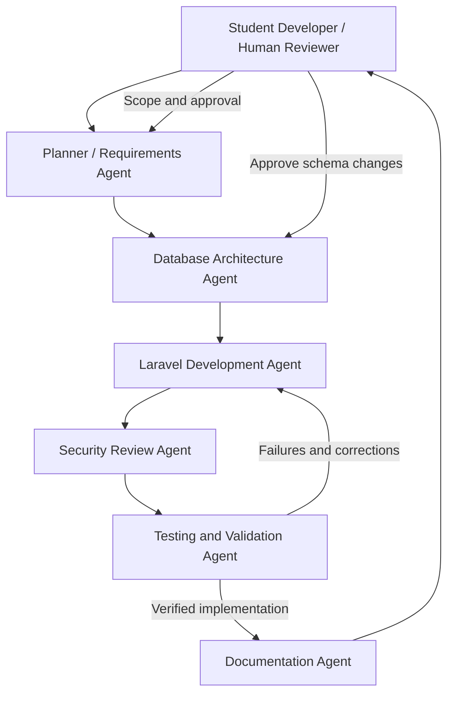

# AI Agent Design and Actual AI-Assisted Development Workflow

**Student Information Management System (SIMS)**  
**NEMSU Tandag Campus — School Year 2026–2027**  
**Document status:** Updated technical draft; independent multi-agent execution **not claimed**  
**Evidence snapshot:** Current workspace, verified November 10, 2026

| Student information | Value |
|---|---|
| Student name | [STUDENT INPUT REQUIRED] |
| Instructor | [STUDENT INPUT REQUIRED] |
| Course/Section | [STUDENT INPUT REQUIRED] |
| Submission date | [STUDENT INPUT REQUIRED] |

## 1. Purpose and scope

The handbook requires an `AGENT_DESIGN.pdf` describing agent architecture, responsibilities, and how AI assistance was organized. This document separates **a proposed specialist-agent architecture** from **the sequential assistant workflow recorded in the project**. A diagram is a design proposal, not proof that independent agents were executed.

## 2. Proposed architecture (not an execution log)

### Proposed responsibilities and handoff contracts

| Proposed role | Bounded responsibility | Proposed output | Human acceptance checkpoint |
|---|---|---|---|
| Planner | Interpret handbook/rubric; identify existing components and gaps | Prioritized requirement-to-file map | Review scope and grading requirements |
| Database | Inspect migrations, foreign keys, catalog, and Eloquent relationships | Safe schema analysis and migration plan | Approve any schema changes; never reset data without explicit authorization |
| Laravel Developer | Implement the approved routes, controllers, requests, views, and API features | Focused code changes and route contract | Review diff and preserve existing Breeze/CRUD behavior |
| Security Reviewer | Check authentication, Administrator/Staff rules, Sanctum authorization, and last-Administrator safeguards | Security findings and regression-test targets | Confirm backend authorization, not merely hidden buttons |
| Testing/Validation | Execute focused and full feature tests, check constraints and errors | Actual test output and unresolved defects | Reject changes when core tests fail |
| Documentation | Update README, API docs, portfolio, and submission evidence | Evidence-backed documentation and gap checklist | Verify claims and supply authentic screenshots/reflection |
| Human Student | Own requirements, actual experience, interpretation, approvals, and submission | Decisions, evidence, final review | Final accountability for submitted work |

A proposed handoff should state the task ID, required behavior, affected files, constraints, expected output, verification command, findings, and remaining risks.

## 3. Actual AI-assisted development workflow

The existing Agent Design records **one assistant-based development workflow performed sequentially**. It does not identify independent specialist agents that executed separate tasks or handed work to one another autonomously. That distinction must remain explicit for an honest C2 assessment.

Recorded workflow milestones include:

1. Inspecting the existing Laravel project rather than starting a new application.
2. Reviewing Student API authentication, Sanctum configuration, validation, models, and migrations.
3. Implementing the Student API and relevant feature tests while preserving Student web routes.
4. Correcting a Student API/web route-name collision detected through route inspection and testing.
5. Replacing an invalid `Student::factory()` test assumption with explicit model creation.
6. Integrating the supplied College → Department → Degree Program catalog without creating fake subjects or replacing legacy student course values.
7. Expanding the Administration Dashboard and addressing role-management concerns.
8. Recording verification results and documentation gaps.

These steps are supported by project documentation and prior reviews. They do **not** prove independently running agents or an autonomous multi-agent orchestration system.

## 4. Context design and token management

| Context scope | Practical information supplied | Risk avoided |
|---|---|---|
| Single-file | One request class, migration, controller, or Blade view | Unnecessary unrelated context |
| Feature | Route + controller + validation + feature tests | Unverified changes to nearby modules |
| Module | Models, CRUD routes, relationships, access rules, tests | Partial understanding of dependent behavior |
| Cross-module | Shared authentication, API policy, catalog relationships | Inconsistent permissions or naming collisions |

### Four handbook questions

**How was unnecessary context reduced?** Development notes describe reading bounded groups of files relevant to each task, such as the Student API controller, request validation, and tests.

**How was prompt repetition avoided?** Prior project constraints were reused through summarized context; later tasks focused on gaps instead of regenerating the entire system.

**How were AI outputs verified?** The documented workflow used route inspection, targeted feature tests, complete test runs, schema checks, Composer validation, Pint checks, and Vite builds. Each claim must be attached to the correct execution record.

**How was token cost balanced against quality?** Focused implementation and targeted tests reduced avoidable rework. **There is no recorded numerical token/cost measurement**, so no percentage savings are claimed.

## 5. Security and human oversight

- Preserve existing Laravel Breeze authentication and database records.
- Confirm authorization on web and API requests at the backend.
- Require Administrator-only Student API write operations where the project policy specifies them.
- Review the protection against removing the final Administrator through both Administration and profile actions.
- Check all new migrations before applying them; do not run destructive resets.
- Avoid fabricated screenshots, model comparisons, execution logs, or personal reflection.
- Maintain real Git commits and obtain explicit authorization for a remote push.

## 6. Real validation evidence and limitations

| Evidence | Source-supported observation | Limit |
|---|---|---|
| Fresh Windows/Laragon suite | **93 passed; 633 assertions** | Ran November 10, 2026; no failures or skips |
| Route and code inspection | 61 routes; all five Student API operations use Sanctum and writes require Administrator | Feature tests cover Staff read-only access and Admin writes |
| SQLite integrity | `integrity_check` returned `ok`; foreign-key check returned no rows | Read-only check of the local database |
| Academic catalog | 7 colleges, 13 departments, 22 programs | Aggregate counts only; no personal record values read |
| Frontend build | Production build passed with a `/images/bg-login.jpg` runtime-resolution warning | The referenced file exists under `public/images`; browser rendering was not checked |
| Composer and Pint | Both checks passed | `git diff --check` passed after fixing an audit-document whitespace issue; Git warned about CRLF normalization |
| Git history and screenshots | 56 commits; 20 screenshot files | Commit count is a point-in-time value; screenshots are development evidence, not live-app proof |

Earlier phases of development reported different test totals; use the latest actual local results for the final PDF and identify older numbers as historical snapshots.

## 7. Risks and limitations

1. A single assistant can impersonate specialist *roles* in prompts without being separate executing agents.
2. Generated code can assume nonexistent factories, route names, or validation syntax.
3. Documentation can become stale as routes, permissions, and Git history change.
4. Tests may pass in a development environment while archived dependencies cannot run on another operating system.
5. Screenshots and first-person reflection must represent real student work.
6. The design document alone is not evidence for any actual multi-agent-execution bonus.

## 8. Conclusions and PDF completion tasks

The proposed architecture offers a clear way to divide responsibilities, define handoffs, and enforce human review. The documented project work demonstrates sequential AI-assisted software engineering and verification, not an independently executed multi-agent system.

The submission PDF renderer turns the Mermaid source into a diagram. The current diagram is labeled as a proposal and is not execution evidence. The export remains a draft until the student reviews its description of the actual workflow and supplies the required cover-page details.

**Status:** Updated source draft. The proposed workflow should remain labeled **proposed** unless authentic independent-agent execution evidence is later supplied.
