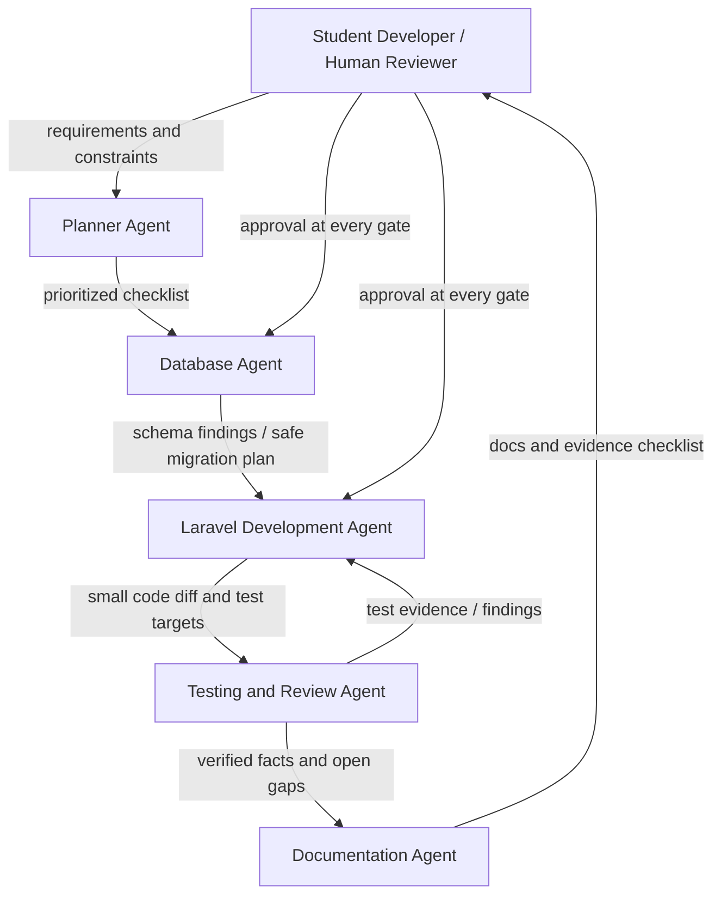

# AI agent design and actual workflow

This Markdown document is the source for the requested `AGENT_DESIGN.pdf`.
The PDF export remains to be done after student review.

## Intended specialized workflow

The following is the proposed architecture for future work. A handoff is a
reviewable artifact with explicit inputs, outputs, and an acceptance gate;
agents must not independently alter unrelated project areas.

| Role | Responsibility | Handoff and acceptance gate |
|---|---|---|
| Planner Agent | Map handbook/rubric requirements to existing files, status, risks, and a prioritized task list. | Requirement-to-file checklist; human confirms scope before edits. |
| Database Agent | Inspect migrations, schema, constraints, relationships, and migration history without resetting or deleting data. | Schema findings and migration plan; verify every proposed migration is additive or explicitly approved. |
| Laravel Development Agent | Implement routes, controllers, validation, authorization, views, and REST endpoints using existing project conventions. | Small, reviewable diff; route list, request/response contract, and affected files handed to Testing Agent. |
| Testing and Review Agent | Add/run focused tests, inspect authorization and validation paths, and identify regressions. | Reproducible test output and unresolved findings; reject changes that fail required assertions. |
| Documentation Agent | Update setup, API, compliance, portfolio, and evidence organization. | Documentation checked against current code and real test output; mark student-owned evidence gaps explicitly. |

The human student owns decisions, credential handling, final review,
screenshots, deployment, and personal reflection. No agent should fabricate
evidence or apply a destructive database command.

## Workflow actually performed for this change

No separate agents were used in the project work recorded in this conversation.
The actual workflow was a single Copilot SDK assistant session with sequential
phases:

1. Reviewed the existing application and supplied requirements before editing.
2. Inspected Sanctum setup and previewed the pending migration; did not reset
   the database.
3. Implemented the API, shared validation, response resource, and tests.
4. Used route inspection and focused tests to catch and correct a naming
   collision and an assumed factory.
5. Prepared documentation from available conversation and repository evidence.
6. Ran the full suite (49 tests / 212 assertions), production asset build,
   Composer validation, targeted Pint check, and migration status check.
   The token migration applied and the existing three SIMS table counts
   remained unchanged.

The proposed role descriptions above are not claims of actual independent
agent execution or handoffs.

## Context and token management

| Scope | Intended context supplied | Example / optimization |
|---|---|---|
| Single file | One request, controller, view, or migration plus its direct contract. | Inspect the shared student request rules on their own when assessing uniqueness and route-bound update behavior. |
| Feature | A behavior, its route/controller, and focused feature tests. | Student API contract plus its feature tests; do not include unrelated dashboard code. |
| Module | Related feature files, role rules, database relationships, and module tests. | Subject or Enrollment routes, controller, models, and tests considered as a module. |
| Cross-module | Only shared dependencies such as auth, roles, schema, or navigation. | Inspect Breeze and role middleware when testing both web and API write restrictions. |

The actual work decomposed the broad requirements into inspection,
implementation, focused testing, documentation, and final validation. It used
the summarized conversation context for prior project decisions, then checked
relevant current files rather than redoing earlier work. Targeted tests gave
quick feedback before a full suite run. Existing schema, authentication, and
middleware were reused.

Smaller tasks and incremental edits are quality controls as well as a token
strategy: they make regressions attributable and make review easier. However,
the user supplied a broad rubric prompt, and the available history has no
token counters, model version, or provider billing data. Therefore this
document explains the method but does not claim measured token savings.

## Communication and handoffs

### Proposed agent-to-agent contract

Each handoff should include: task identifier, relevant requirement, bounded
file scope, constraints, expected output, verification command, findings, and
unresolved risks. The receiver reports evidence and does not silently expand
scope. Planner checkpoints task order; Database Agent gets human approval
before migration; Testing Agent gates acceptance; Documentation Agent only
records verified behavior.

### Actual communication

No separate agents were used. The user supplied requirements and constraints
to one assistant session. The assistant used tool results (file reads, route
list, tests, build, migration output) to inform subsequent edits and
verification. This is a sequential single-assistant workflow, not a
multi-agent handoff, and earns no claim of actual multi-agent bonus evidence.

## Human oversight and verification

- Human-provided requirements define scope; preserve working code and data.
- Review routes/middleware to confirm server-side authorization rather than
  relying on UI controls.
- Inspect migration SQL before application and compare existing record counts
  before and after.
- Require focused and full automated tests, route inspection, formatter,
  dependency validation, and build before declaring complete.
- Keep screenshots, model metadata, comparison studies, and personal
  reflection student-owned; never fabricate evidence.
